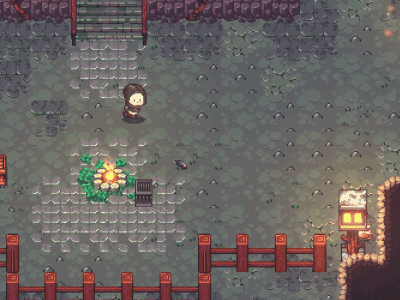
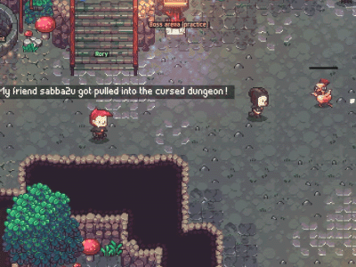
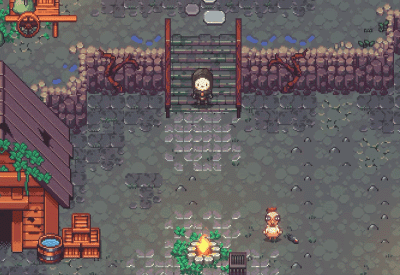
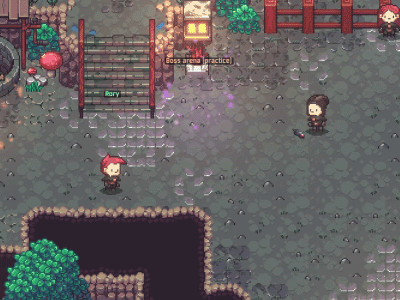
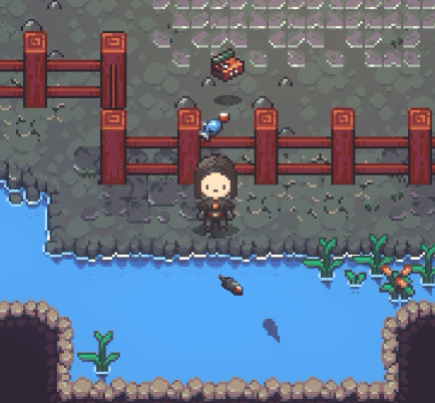
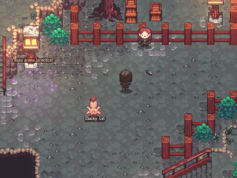

# emberville.multiplayer


Unofficial online co-op and a set of gameplay mods for **Emberville** (the demo; Unity 6, Mono), as BepInEx 5 plugins.
Not made or supported by Cygnus Cross.

- **Download:** the [Releases](../../releases) page: **EmbervilleModPack** has everything in one zip. New builds go up
  often; everyone playing together needs the same version.
- **Install:** unzip it into the Emberville Demo folder (Steam > right-click Emberville Demo > Manage > Browse local
  files), so `winhttp.dll` and the `BepInEx` folder sit next to `Emberville.exe`. To leave a mod out, delete its folder
  in `BepInEx\plugins`.
- **Commands and API:** [API.md](API.md) (every chat command, NPC dialogue lines, and C# for other mods).
- Notes and the roadmap: [`todo.md`](todo.md).

## Contents
[Playing together](#playing-together) · [Travel: town portal, /tp, /summon](#travel-town-portal-tp-summon) ·
[The descent and the boss arena](#the-descent-and-the-boss-arena) · [Weapons and summons](#weapons-and-summons) ·
[Your character](#your-character) · [Chests and loot](#chests-and-loot) · [Weather](#weather) ·
[NPCs and quests](#npcs-and-quests) · [Fishing](#fishing) · [Pets](#pets) · [Quality of life](#quality-of-life) ·
[Keys](#keys) · [Commands](#commands) · [API](#api) · [Secrets](#secrets-the-dev-panel-test-arenas-and-the-estate) ·
[Build](#build)

## Playing together
- **Steam (easiest):** host with **F9 > Host via Steam**; friends join from their Steam friends list (right-click >
  Join Game) or an invite (Insert menu > Invite friends). No IP address, no port forwarding (Steam's relay). The mod
  brings Steamworks itself (the demo has none).
- **By IP:** host with **F9**, friends press **F10** and type the host's IP. Over the internet the host has to forward
  **UDP port 9060** on their router; on the same home network nothing's needed. If the host leaves, the player who
  joined first takes over and the others reconnect to them.
- **Other players** are real characters: looks, gear and dyes, animations, name, health and Kymia bars, what they're
  doing, status effects, damage numbers, a speech bubble while they type.
- **One shared world:** creatures (run by whoever is nearest), bosses and their phases, attacks and spells, gory deaths,
  drops (dupe-proof), chests, breakables, ore and trees, doors, levers, key altars, floor buttons, town repairs, the
  clock, story progress and cutscenes, every crafting station, farm plots, building on the estate, NPCs (everyone sees
  the host's NPCs looking the same), the weather.
- **Party strip** (top): every player with health and Kymia; live character portraits (Insert > Online / Hosting) or
  their weapon. Right-click a card: teleport, trade, mute. Off-screen teammates get edge arrows; teammates show on the
  minimap and the world map (M).
- **Online Players (O):** who's online and where; teleport to them, trade, mute; the host can kick and ban.
- **Trading:** Online Players > Trade, or `/trade <name>`: drag items into your offer, both tick Ready, the swap happens
  once both agree on exactly the same two offers.
- **Chat** (Enter), pings and drawing on the ground (middle mouse), death announcements.
- **Dungeon invites:** when a teammate goes into a dungeon or down a floor of the descent, a card offers Join.

## Travel: town portal, /tp, /summon
- **Town Portal** (button on the right edge, half way down): hold still 3 seconds (moving or being hit stops it). A
  swirling portal opens where you stand, its twin opens in town (the demo: by the starting door), and you're taken home.
  Step into either end, you or your friends, to go to the other; on a dungeon or descent floor it builds that floor
  again and puts you at the portal. Each player has one pair, with their name over it, until they open a new one.
- **`/tp <name>`:** go to a player, even onto their dungeon floor. **`/summon <name>`** or **`/summon all`:** bring
  them to you, now.

## The descent and the boss arena
- **The descent:** the full game's dungeon generator ships in the demo; the mod builds the levels. Up the path from the
  starting door, the **water well** is the way down (and the **lamp** the boss arena, with **Rory** the archer between).
  Set a seed, how many floors, how much stronger each floor gets, how many creatures, and the layout (Sprawl). Each
  floor has chests (better loot deeper), the stairs at the far end, a mini-boss guardian every 5th floor (now and then
  it drops a staff), a minimap, and a blue pad or the Leave button back to where you came in. Everyone gets the same
  floors.
- **Boss arena** (the lamp): a walled floor with pillars, spike traps and arrow shooters, and a panel to make mini-bosses
  from the game's creatures (name, colour, size, health, damage). **Boss rush:** 30 bosses, tougher each wave.


## Weapons and summons
Type the command in chat to get one.
- **Staff of Clucking (`/clucking`):** right-click summons a battle chicken (a tenth of your Kymia); left-click is a
  normal attack.
  
  
  
- **Staff of the Risen (`/risen`):** creatures that die near you glow green; right-click near one raises it to fight
  for you (a fifth of your Kymia).
  
  
  
- With either staff, **middle-click** sends your chickens or risen there (they path around walls and water). Both
  staffs level up as you use them; summons go out in their creature's gore burst.
- **Hunter's Hook (`/hook`):** right-click throws it (a sixth of your Kymia): it drags a creature to your feet, stunned
  (big guardians pull you to them instead), with a spray of blood. While it's in your hand your whole outfit turns
  Scorpion yellow.
  
  


## Your character
- **Respec:** `/respec`, or ask Ellie: every stat point back to spend again (level, XP and gear kept).
- **Dye your gear:** right-click an equipped item in your inventory's gear slots, pick one of 12 colours, **Dye** (or
  Cancel). The dye stays with the item and your friends see it.
- **Favourite weapons:** hover a weapon in your inventory and press **F5-F8** to put it on that key; F5-F8 wield it
  (the boxes sit between the two skulls on the HUD), or hold **Left Alt** (gamepad LT) for a weapon wheel.
- **Bestiary (N):** every creature you've killed, with its stats and your kill count.
- **Lock-on (G):** point at an enemy and press **G**: you face it whatever the mouse does (circle and strafe round it),
  and swings, spells and arrows go at it; a ring under it shows the lock. G on it again lets go; G pointing at nothing
  locks the nearest enemy, again the next one. When it dies the lock moves on to the next one close by. Enemies only
  (creatures, spider eggs): never doors, barrels or furniture. The Hunter's Hook throws at the locked enemy too.
- **Better Combat:** move while attacking (`/moveattack`), bows that aim in any direction and lock on (`/bowlock`).
  
  


## Chests and loot
- **F** on an item marks it a favourite (a heart on its slot): favourites never get swept into chests.
- At a chest: **X** puts in everything the chest already holds; **V** customizes it (name, colour, and what it takes:
  items it refuses grey out in your bag).
- **Search boxes** above your bag and an open chest.
- **Ctrl+click** an item while a chest is open: it goes straight across (bag to chest, chest to bag).
- **Shared stash (U, or `/stash`):** a big chest you can open anywhere: 6 tabs of 30 slots, shared by every character
  on your PC. Right-click a tab to rename it and give it a colour. Kept in its own file next to your saves, with a
  backup. (There's a Stash button under the Town Portal button too.)
- A renamed chest shows its own name straight away (no more "Chest" for a moment first).
- **Better Looting:** the magnet picks up items near you (Insert menu: range and kinds), and a green arrow marks better
  gear.

## Weather
Insert > **Weather** (Clear / Rain storm / Snow), or `/rain`, `/snow`, `/clear`. One weather for everyone; outside only.
- **Rain:** pixel rain across the screen, slanted by a shifting, gusting wind; splashes on the ground (under trees and
  props), rings on open water; lightning strikes now and then with a flash; the sky goes dark.
- **Snow:** drifting flakes; the ground whitens over a few minutes (32 stages, the first see-through, thinning toward
  water and cliffs, in several shades of white), trees and other things get snow caps, you leave footprints; it slowly
  melts when it stops.
- **Sliders:** rain drops, snowflakes, how fast snow settles, how dark the rain / snow sky gets, lightning. Other mods
  and NPC scripts can set the weather with settings of its own ([API.md](API.md)).

## NPCs and quests
- **Ellie** (in the starting area): a two-part quest (wood, then a sword) with a reward; she'll give you a chicken or
  either staff, and can respec you. Her portrait in the dialogue window is her, live.
- **Make your own:** NPCs, dialogue (Twine `.twee`) and quests from text files: see `README-BetterNPCsAndQuests.txt` in
  the download. Dialogue can run any chat command (`(trigger: "command snow on")`).
- In co-op everyone shares the host's NPCs and story.


## Fishing
Every catch brings something up (food, materials, sometimes rare gear), and you can fish wherever there are fish
shadows in the water, the starting area too. Cast, wait for the bite, left-click quickly.




## Pets
`/pet on`, then `/pet` befriends a pet that follows you, fights with you and levels up. 13 kinds (Chicken, Glowbat,
Lilshrooms, Lil Ticks, Lil Bombers, Spiderling, Bug Fuzz): `/pet list`, `/pet glowbat`, `/pet name ...`,
`/pet color red`. Everyone sees your pet.




## Quality of life
- **Mouse walking:** hold the mouse side button to walk toward the mouse; a click walks there.
- **Sleep vote:** everyone types `/sleep` and the clock skips to the morning.
- **Team buffs:** a buff you cast on yourself also lands on teammates near you (host option).
- **Keep playing after the demo:** its "Thank you for playing" stop is skipped.
- **Your characters are safe:** before joining, the character files are backed up (`Saves/EmbervilleGhost_Backups`).
- **Typing anywhere** (chat, a chest's name, search boxes, the stash's tab names) keeps the mods' hotkeys out of it.
- **Font Options** (Insert menu): the story text's size (what NPCs say, speech bubbles, the quest tracker: the boxes
  grow with it), the size of the words in the world ("Open", "Examine", names over heads), and the font for all the
  game's text: the game's own Emberfont, Noto Serif, Liberation Sans or Perfect DOS VGA.
- **Tilted view (experimental, `/tilt` or Insert > View):** the world seen from behind and above at an angle, the
  floor receding and everything that stands (you, creatures, props, trees) stood up facing you, like a pop-up book.
  Only the picture changes: the game plays exactly as before, and your aim follows what you see. Tilt and field of view
  are sliders. The ground's tiles (walls too) stay flat.
- **Staff tooltips** sit beside the item card, and off the second card when the game shows two side by side.
- **Title screen:** Better & Online under the Emberville logo; the Next Fest popup is skipped.


## Keys
| Key | What |
|---|---|
| F9 / F10 | host (IP or Steam) / join (again: disconnect) |
| Insert | the mods' menu (every switch and slider) |
| Enter | chat (and `/commands`) |
| O | Online Players |
| N | Bestiary |
| F5-F8, hold Left Alt | wield a favourite weapon, weapon wheel |
| G | lock on to the enemy under the mouse (again: let go); at nothing: the nearest / the next one |
| F (on an item) | favourite it (heart) |
| X / V (at a chest) | put matching items in / customize the chest |
| Ctrl+click (chest open) | move the item across |
| U | the shared stash |
| Right-click (gear slot) | dye the item |
| Right-click (staff / hook) | summon, raise, throw |
| Middle mouse | ping, draw; with a staff: send your summons |
| Mouse side button | walk toward the mouse |
| Town Portal button (right edge) | a portal home |
| Delete | the status line (top left) |

## Commands
The full list is in [API.md](API.md#chat-commands). The main ones: `/tp`, `/summon`, `/trade`, `/online`, `/sleep`,
`/respec`, `/rain`, `/snow`, `/clear`, `/hook`, `/clucking`, `/risen`, `/pet`, `/dungeon`, `/estate`, `/repair`,
`/resources`, `/stash`, `/tilt`, `/bowlock`, `/moveattack`; testing: `/nodeath`, `/onehitkill`, `/noclip`, `/devmode`, `/devpanel`.

## API
Other BepInEx mods (and NPC dialogue) can drive these mods; the full reference with examples is in [API.md](API.md).
- **Multiplayer** (`EmbervilleGhost.Api`): `Command`, `Online`, `Players`, `TeleportTo`, `Summon`, `SummonAll`, `Teleport`.
- **Weather** (`BetterWeather.Plugin`): `SetWeather(kind)`, `SetWeather(kind, new WeatherOptions { Amount, Darkness,
  Settle, LightningEvery, Wind })`, `StrikeAt(position)`, `Current`.
- **Pets and summons** (`BetterPetsAndSummons`): `Plugin.Command`, `Plugin.Rally`, `Plugin.HoldingStaff`, staffs'
  `Make` / `Give`.
- **NPCs and quests** (`BetterNPCsAndQuests`): `Events.Raise`, `Plugin.Bodies`; any mod's `Command(string)` /
  `NpcFlag(string)` is picked up by dialogue.
- **Chests** (`BetterChests.ChestLooks`): `Set`, `All`, `TakesOf`, `Changed`.
- **Favourite weapons** (`EmbervilleFavorites.Favorites`): `Wield`, `Find`, `HasKey`, `KeyOf`.
- **Combat** (`BetterCombat`): `BowAssist.SetAngle`, `BowAssist.Toggle`, `MoveAttack.Command`.

## Secrets: the dev panel, test arenas and the estate
- **The dev panel:** the demo still has the developers' tools, switched off. `/devmode` switches them on:
  **Ctrl+Shift+Numpad7** opens the developer panel (go to Town, unlock skills, heal, advance time...), `/devpanel` opens
  it without a numpad.
- **Test arenas:** `/arena` teleports you to the scene's test arena; Numpad1 spawns monster groups there.
- **The estate (your house and farm in Town):** `/estate` (host) unlocks building and repairs. **Repairing the town:**
  `/resources`, walk onto a ruin and press F (or `/repair`); everyone sees it repaired.

## Build
Requirements: .NET SDK, Emberville installed with BepInEx 5.4.23 (`winhttp.dll`, `doorstop_config.ini`,
`.doorstop_version` and `BepInEx/core` in the game folder).
```
dotnet build spike/EmbervilleGhost -c Release -p:GamePath="<path to Emberville Demo>"
```
Each mod is its own project in `spike/` (EmbervilleGhost = multiplayer, EmbervilleFavorites, BetterChests, BetterCombat,
BetterLooting, BetterPetsAndSummons, BetterFishing, BetterNPCsAndQuests, BetterWeather); a build copies the DLL into the
game's `BepInEx/plugins`. The game's own DLLs are referenced from `<GamePath>/Emberville_Data/Managed` (not included).

**Release zip:** `pwsh spike/package-all.ps1` makes `spike/dist/EmbervilleModPack-v<version>.zip` (BepInEx and every
mod, each with its own README).

**Testing on one PC:** launch `Emberville.exe` twice (don't load the same character in both).

## Not included
No game code or assets: the decompiled reference used for research stays local (`reference/`, git-ignored).
`spike/libs/OverlayDearImGui`: ImGui.NET + cimgui (MIT). `spike/libs/Steamworks`: Steamworks.NET (MIT) + Valve's
redistributable `steam_api64.dll`.
